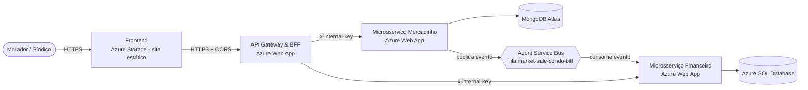
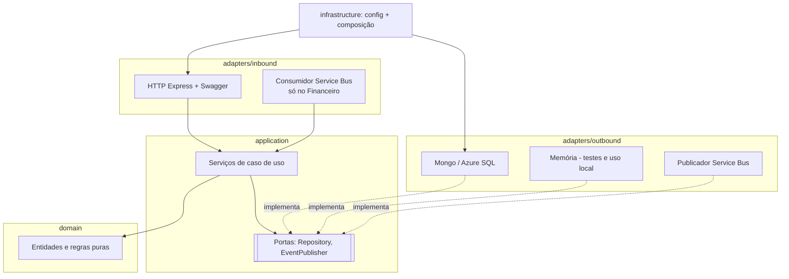
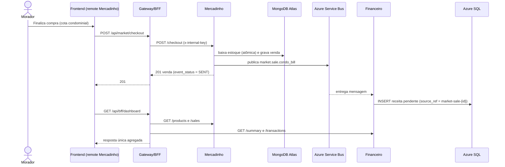
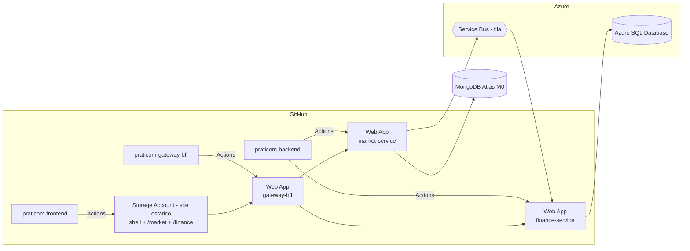

# Praticom · API Gateway & BFF

Ponto **único de entrada** do Praticom. Ele roteia as chamadas do frontend para os microsserviços, cuida da segurança e do CORS, agrega dados de mais de um serviço em uma única resposta (BFF) e documenta tudo no Swagger.

| | Endereço |
|---|---|
| 🔀 **Gateway publicado (Azure Web App)** | https://SEU-GATEWAY.azurewebsites.net |
| 📘 Swagger | https://SEU-GATEWAY.azurewebsites.net/docs |
| 🌐 Site (Azure Storage, site estático) | https://SEU-SITE.z1.web.core.windows.net |
| 🎥 Vídeo de apresentação (YouTube, não listado) | https://youtu.be/SEU-VIDEO |
| 📦 Repositório do frontend | https://github.com/SEU-USUARIO/praticom-frontend |
| 📦 Repositório dos microsserviços | https://github.com/SEU-USUARIO/praticom-backend |

**Alunos:** veja [GRUPO.md](GRUPO.md).

## Responsabilidades

| Requisito | Implementação |
|---|---|
| Roteamento / proxy (CRUD) | `/api/market/*` vai para o Mercadinho; `/api/financial/*` vai para o Financeiro. Só as rotas públicas de cada serviço são liberadas |
| Agregação, tudo em um único response | `GET /api/bff/dashboard` (Mercadinho + Financeiro) e `GET /api/bff/sales` (venda + lançamento gerado + unidade/morador) |
| Segurança | Helmet, rate limit, limite de corpo (100 kB) e chave interna `x-internal-key` enviada aos microsserviços |
| CORS | Lista de origens em `CORS_ORIGINS` (endereço do site estático) |
| Centralização da entrada | O frontend não conhece o endereço dos microsserviços |
| Observabilidade | `X-Correlation-Id`, `X-Gateway-Processed-By`, `X-Gateway-Execution-Time-Ms`, `GET /api/bff/status` |
| Swagger | `/docs` |

## Estrutura (hexagonal)

```
src/
├── application/                # casos de uso do BFF (BffService), agregação pura, portas, dados de referência
├── adapters/inbound/http/      # Express: rotas, proxy, segurança, Swagger (openapi.js)
├── adapters/outbound/          # ServiceClient: cliente HTTP dos microsserviços (timeout + chave interna)
├── config.js                   # variáveis de ambiente
└── server.js                   # composição e inicialização
```

## Como rodar localmente

Pré-requisitos: Node.js 20+ e os dois microsserviços rodando (veja o repositório `praticom-backend`).

```bash
npm install
cp .env.example .env    # para uso local: MARKET_SERVICE_URL=http://localhost:5001, FINANCE_SERVICE_URL=http://localhost:5002
npm run dev
```

O Swagger fica em http://localhost:5000/docs.

## Testes

```bash
npm test
```

- **Unitários:** funções de agregação e enriquecimento; rotas HTTP com microsserviços simulados (proxy, agregação, CORS, erros 4xx/5xx repassados, serviço fora do ar).
- **Arquitetura** (`test/architecture.test.js`): a camada `application` não depende de Express nem de adaptadores; adaptadores de entrada e de saída não se conhecem.

## Deploy no Azure Web App

1. Crie um **Web App** com publicação *Código*, pilha **Node 20 LTS** e sistema **Linux**. O plano F1 (gratuito) atende; o B1 evita a hibernação.
2. Em *Configurações > Variáveis de ambiente*, cadastre `MARKET_SERVICE_URL`, `FINANCE_SERVICE_URL`, `INTERNAL_API_KEY` e `CORS_ORIGINS` (veja `.env.example`). Não defina `PORT`, porque a Azure já define.
3. Em *Configurações > Configuração > Configurações gerais*, ative **SCM Basic Auth Publishing Credentials** e baixe o **perfil de publicação** (*Visão geral > Baixar perfil de publicação*).
4. No GitHub, abra *Settings > Secrets and variables > Actions* e cadastre o secret `AZURE_WEBAPP_PUBLISH_PROFILE` (conteúdo do arquivo) e a variable `AZURE_WEBAPP_NAME` (nome do Web App).
5. Faça push na `main`. O workflow `.github/workflows/azure-webapp.yml` testa e publica.

## Arquitetura (Arc42)

A solução é a mesma nos três repositórios; esta seção descreve o sistema inteiro e indica o papel de cada repositório.

### 1. Introdução e objetivos

O **Praticom** é um ERP de gestão condominial. Esta entrega publica na nuvem Azure dois módulos dele, reaproveitando telas e regras do projeto original (`Richanhe/Praticom`):

- **Mercadinho autônomo**: cadastro de produtos, controle de estoque e PDV (caixa de autoatendimento do morador).
- **Financeiro**: lançamentos a pagar e a receber, baixa de pagamento, resumo e inadimplência por unidade.

Regra de negócio que liga os dois: **quando o morador paga uma compra do mercadinho com débito na cota condominial, o Financeiro cria automaticamente uma receita pendente para a unidade, com vencimento em 30 dias.** Essa comunicação acontece por mensagem no **Azure Service Bus**.

| Objetivo de qualidade | Como é atendido |
|---|---|
| Independência entre módulos | Um microsserviço e um microfrontend por domínio, cada serviço com o próprio banco |
| Manutenibilidade | Arquitetura hexagonal com regras de dependência verificadas por testes de arquitetura |
| Segurança | Entrada única pelo Gateway (CORS, Helmet, rate limit) e chave interna entre Gateway e serviços |
| Resiliência | Mensageria assíncrona, eventos idempotentes, dead-letter e degradação parcial no BFF |

**Partes interessadas:** síndico/administradora (financeiro), moradores (compras no PDV), equipe de desenvolvimento e professor avaliador.

### 2. Restrições

- Nuvem **Azure**: Conta de Armazenamento com site estático (frontend; o Static Web Apps não está disponível nas regiões liberadas pela política da assinatura Azure for Students da PUCPR), Web App/App Service (Gateway e microsserviços), Azure SQL Database, Azure Service Bus; **MongoDB Atlas** (Free Tier) para o Mercadinho.
- Frontend em **React** com **Module Federation** (microfrontends).
- Três repositórios públicos: frontend, gateway e backend.
- O frontend só conversa com o Gateway/BFF, nunca com os microsserviços.
- Stack: Node.js 20 + Express nos backends (mesma do Praticom original); React 18 + Vite 5 no frontend.

### 3. Contexto e escopo



Fora do escopo: encomendas, portaria, reservas e comunicados do Praticom original. Unidades e moradores são **dados de referência fixos servidos pelo BFF**, porque o cadastro de pessoas é outro domínio, que não faz parte destes dois microsserviços.

### 4. Estratégia de solução

| Decisão | Motivo |
|---|---|
| **Arquitetura Hexagonal (Ports & Adapters)** nos microsserviços e no Gateway | Domínio sem dependência de banco, HTTP ou broker; adaptadores trocáveis (Mongo/SQL ↔ memória nos testes) |
| **Database per Service** | Mercadinho em MongoDB (documentos de produto/venda) e Financeiro em Azure SQL (dados contábeis relacionais) |
| **API Gateway + BFF** em um único projeto | Ponto único de entrada (roteamento, segurança, CORS, Swagger) e respostas agregadas para as telas |
| **Microfrontends com Module Federation** | Shell (host) + remote Mercadinho + remote Financeiro, carregados em tempo de execução |
| **Mensageria assíncrona** (Service Bus) | O Mercadinho não depende do Financeiro estar no ar para concluir uma venda |
| **Reaproveitamento** | Telas `MarketInventoryView` e `FinancialView` e regras dos DAOs do Praticom foram mantidas |

### 5. Visão de blocos de construção

**Nível 1: repositórios**

| Repositório | Conteúdo |
|---|---|
| `praticom-frontend` | `shell/` (host), `mfe-market/` (remote), `mfe-finance/` (remote), `shared/api.js` (cliente do BFF) |
| `praticom-gateway-bff` | Proxy/roteamento, agregações BFF, segurança, Swagger |
| `praticom-backend` | `market-service/` (MongoDB) e `finance-service/` (Azure SQL) |

**Nível 2: camadas hexagonais de cada microsserviço**



Regras garantidas pelos testes de arquitetura (`test/architecture.test.js`):
- `domain` não importa nenhuma outra camada nem pacote externo;
- `application` depende só de `domain`;
- adaptadores de entrada não conhecem adaptadores de saída (e vice-versa).

| Microsserviço | Responsabilidade | Endpoints (sem o prefixo do gateway) |
|---|---|---|
| Mercadinho | Produtos, estoque, PDV e vendas | `GET/POST /products`, `GET/PATCH/DELETE /products/{id}`, `PATCH /products/{id}/stock`, `POST /checkout`, `GET /sales` |
| Financeiro | Lançamentos, baixa, resumo e inadimplência | `GET/POST /transactions`, `GET/PATCH/DELETE /transactions/{id}`, `PATCH /transactions/{id}/pay`, `GET /summary` |

**Gateway/BFF**

| Rota pública | Tipo | Destino |
|---|---|---|
| `/api/market/*` | Proxy (roteamento) | Microsserviço Mercadinho |
| `/api/financial/*` | Proxy + enriquecimento (bloco/apto) | Microsserviço Financeiro |
| `/api/bff/dashboard` | **Agregação** | Mercadinho + Financeiro em uma única resposta |
| `/api/bff/sales` (= `/api/market/sales`) | **Composição** | Venda (Mongo) + lançamento gerado (Azure SQL) + unidade/morador |
| `/api/bff/status` | Saúde | Estado dos dois microsserviços |
| `/api/units`, `/api/residents` | Referência | Dados fixos do BFF |
| `/docs` | Swagger | Documentação OpenAPI |

**Microfrontends**

| App | Tipo | Expõe/consome | Publicado em |
|---|---|---|---|
| `shell` | Host | Menu, tema, notificações e a **Visão geral** (usa `/api/bff/dashboard`) | `/` |
| `mfe-market` | Remote | Expõe `./MarketApp` (tela de Mercadinho e PDV) | `/market/assets/remoteEntry.js` |
| `mfe-finance` | Remote | Expõe `./FinanceApp` (tela Financeiro) | `/finance/assets/remoteEntry.js` |

### 6. Visão de execução

**Compra no PDV debitada na cota condominial**



Contrato da mensagem:

```json
{ "eventId": "uuid", "type": "market.sale.condo_bill", "saleId": 12, "unitId": 2, "residentId": 2, "amount": 16.9, "occurredAt": "2026-11-05T21:00:00.000Z" }
```

**CRUD de lançamento:** `Frontend → POST/PATCH/DELETE /api/financial/transactions → Gateway → Financeiro → Azure SQL`.

### 7. Visão de implantação



| Componente | Serviço Azure | Variáveis principais |
|---|---|---|
| Frontend | Conta de Armazenamento (site estático `$web`) | `VITE_API_URL` (no build) |
| Gateway/BFF | Web App Node 20 (Linux) | `MARKET_SERVICE_URL`, `FINANCE_SERVICE_URL`, `INTERNAL_API_KEY`, `CORS_ORIGINS` |
| Mercadinho | Web App Node 20 (Linux) | `MONGODB_URI`, `MONGODB_DB`, `SERVICEBUS_CONNECTION_STRING`, `SERVICEBUS_QUEUE`, `INTERNAL_API_KEY` |
| Financeiro | Web App Node 20 (Linux) | `SQL_CONNECTION_STRING`, `SERVICEBUS_CONNECTION_STRING`, `SERVICEBUS_QUEUE`, `INTERNAL_API_KEY` |

### 8. Conceitos transversais

- **Segurança:** CORS com lista de origens, Helmet (cabeçalhos seguros), limite de requisições por minuto e JSON limitado a 100 kB no Gateway. Os microsserviços exigem o header `x-internal-key`, que só o Gateway conhece. Consultas SQL são sempre parametrizadas.
- **CORS:** centralizado no Gateway; os microsserviços não são chamados pelo navegador.
- **Rastreabilidade:** o Gateway gera/propaga `X-Correlation-Id` e devolve `X-Gateway-Processed-By` e `X-Gateway-Execution-Time-Ms`.
- **Erros:** regras de negócio violadas viram HTTP 400, recurso inexistente vira 404, serviço fora do ar vira 502/504 no Gateway. Mensagens em português, exibidas pelas telas.
- **Mensageria confiável:** consumo com *peek-lock*; mensagem inválida vai para a *dead-letter queue*; erro técnico devolve a mensagem para nova tentativa; o Financeiro é **idempotente** (índice único em `source_ref`), então uma entrega repetida não duplica a cobrança.
- **Consistência no Mercadinho:** baixa de estoque atômica no Mongo (`$inc` com filtro de estoque suficiente) e compensação (devolução do estoque) se algum item do carrinho falhar.
- **Status calculado:** um lançamento pendente com vencimento anterior a hoje é exibido como `OVERDUE`, no fuso `America/Sao_Paulo`.
- **SOLID:** responsabilidade única por camada e serviço; inversão de dependência pelas portas (`ProductRepository`, `SaleRepository`, `EventPublisher`, `TransactionRepository`, `ServiceClientPort`); adaptadores substituíveis sem mudar o domínio (aberto/fechado e substituição de Liskov nos repositórios em memória × banco).
- **Testes:** `node --test` em todos os projetos: unitários (domínio, serviços, HTTP) e de arquitetura.

### 9. Decisões de arquitetura

| # | Decisão | Alternativa descartada | Motivo |
|---|---|---|---|
| D1 | Partir do Praticom e quebrar em serviços | Projeto novo do zero | Prazo curto; telas e regras já existiam |
| D2 | Mercadinho + Financeiro como domínios | Reservas + Financeiro | Menos dependências entre tabelas no código original; o débito em cota já era regra existente |
| D3 | Hexagonal | Clean/Onion | Separação clara entre portas e adaptadores; fácil testar com adaptadores em memória |
| D4 | Fila do Service Bus (não tópico) | Chamada HTTP síncrona | Desacopla a venda da disponibilidade do Financeiro |
| D5 | Remotes publicados no mesmo site estático | Um site por remote | Um único deploy e sem CORS para o `remoteEntry.js` |
| D6 | Unidades/moradores fixos no BFF | Terceiro microsserviço | Fora do escopo exigido; mantém as telas originais funcionando |

### 10. Requisitos de qualidade

| Cenário | Resposta esperada |
|---|---|
| Financeiro fora do ar durante uma compra na cota | A venda é concluída; a mensagem fica na fila e é processada quando o serviço voltar |
| Mesma mensagem entregue duas vezes | Apenas um lançamento é criado |
| Mercadinho fora do ar ao abrir a Visão geral | O BFF devolve os dados do Financeiro e um aviso em `warnings` |
| Chamada direta a um microsserviço sem a chave | HTTP 401 |
| Site de outra origem chamando o Gateway | Bloqueado pelo CORS |
| Remote não carrega | Só a área dele mostra erro; o shell continua funcionando |

### 11. Riscos e débitos técnicos

- Plano gratuito (F1) do App Service hiberna sem uso: a primeira chamada após um tempo parado demora, e o consumidor do Service Bus só processa mensagens quando o Financeiro está acordado (as mensagens não se perdem).
- Unidades e moradores são fixos no BFF; um cadastro real exigiria um terceiro serviço.
- Não há autenticação de usuário final (login); a proteção é de perímetro (Gateway) e entre serviços (chave interna).
- Se o Service Bus falhar no momento da venda, ela fica com `event_status = PENDING` e não há reenvio automático.

### 12. Glossário

| Termo | Significado |
|---|---|
| BFF | *Backend for Frontend*: camada que agrega e adapta dados para as telas |
| Gateway | Ponto único de entrada que roteia, protege e documenta as APIs |
| Microfrontend | Parte da interface construída e publicada de forma independente |
| Module Federation | Recurso que permite a um app (host) carregar módulos de outro app (remote) em tempo de execução |
| Remote / Host | App que expõe módulos / app que os consome |
| Cota condominial | Taxa mensal cobrada de cada unidade |
| Dead-letter | Fila para mensagens que não podem ser processadas |
| Idempotência | Repetir a mesma operação não altera o resultado |
| PDV | Ponto de venda (caixa de autoatendimento do mercadinho) |

